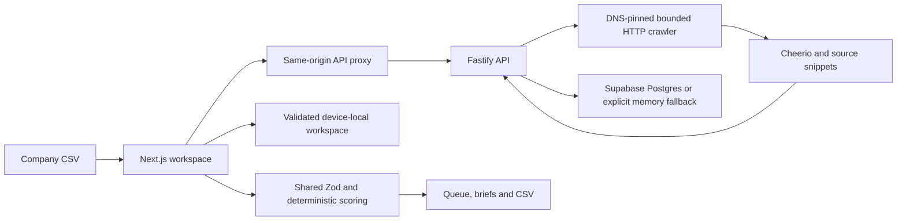

# DealLens

Turn company lead lists into evidence-backed acquisition research priorities.

DealLens delivers **explainable lead qualification** and **source-backed acquisition research output** for search funds, private equity, and corporate development teams. It grounds every qualification decision in deterministic scoring and verifiable evidence, avoiding hallucinated financials or unsolicited cold outreach.

## Business rationale

DealLens bridges top-of-funnel lead generation with deep acquisition diligence: import discovered target leads, apply an acquisition buy box, distinguish ownership indicators from evidence confidence, and export a research shortlist directly into existing spreadsheet or CRM workflows.

The outcome is a reviewable next action with supporting quotes and explicit unknowns. The default illustrative dataset contains **46 rows, 2 duplicates removed, and 44 companies**: **3 Pursue now, 34 Research owner, 3 Monitor, 4 Skip**.

## Run locally

Requires Node **22.12+** and pnpm 9+ (tested on Node 22 and 24).

```bash
# 1-step launch: compiles packages and starts both API and Web services:
./start.sh
# or: pnpm dev:all
```

Alternatively, run in separate terminals:
```bash
pnpm install --frozen-lockfile
pnpm build
# Terminal 1: Fastify API (Port 3001)
pnpm --filter @deallens/api dev
# Terminal 2: Next.js Frontend (Port 3000)
pnpm --filter @deallens/web dev
```

Open [the local workspace](http://localhost:3000). [API health](http://localhost:3001/health) exposes `memory`, `supabase` or `degraded` persistence. The offline demo requires no account, environment variables, crawler or LLM.

For development, run `pnpm dev:api` and `pnpm dev` in separate terminals. The API dev command compiles and runs; restart it after changes.

## Quality checks

```bash
pnpm --filter shared build
pnpm typecheck
pnpm lint
pnpm test
pnpm build
```

Lint is noninteractive and covers all three packages. Tests cover scoring, normalization, imports/exports, run isolation, API validation, conservative extraction, DNS/IP/redirect restrictions, socket address pinning, streamed byte limits, body/DNS timeouts, typed crawl failures and persistence restart contracts. External HTTP and database dependencies are mocked for reproducibility; these are not load tests or proof of live site extraction accuracy.

## Architecture and exact technologies

- Web: Next.js 14 App Router, React 18, strict TypeScript, Mantine 7, Tailwind 3, TanStack Table 8.
- API: Fastify 4, TypeScript, Zod, Cheerio, Node HTTP(S), p-limit.
- Shared: Zod domain/request/run/workspace schemas, deterministic scoring, normalization, CSV serialization, reports and fixture data.
- Database: Supabase Postgres with committed migrations; optional memory fallback.



The page is prerendered, then becomes an interactive workspace. Website research and webhooks require the Node API; a static-only host cannot provide them. See [architecture documentation](docs/architecture.md) and [database setup](docs/supabase-cli.md).

## Configuration and database

Copy `.env.example` to root `.env` or `apps/api/.env` for backend settings. The API loads root settings, then local settings; local file values take precedence. All backend settings are parsed in `apps/api/src/lib/config.ts`. Put `API_BASE_URL` in `apps/web/.env.local` for the Next.js server proxy and rebuild after changing it.

```text
PORT=3001
HOST=0.0.0.0
SUPABASE_URL=https://your-project.supabase.co
SUPABASE_SERVICE_ROLE_KEY=your-server-only-key
CRAWL_TIMEOUT_MS=5000
CRAWL_MAX_CONCURRENCY=4
```

Apply migrations with the [Supabase CLI workflow](docs/supabase-cli.md). The new snapshot migration is required for persistence. Database errors are logged without credentials, exposed in health/API metadata, and shown during UI research. Supabase persistence stores companies, evidence, theses, analyses and immutable run snapshots; validated records are hydrated on API restart. Migrations and mock read/write/restart behavior are tested locally; remote application/readback must be checked on your configured project before claiming live persistence.

The browser saves validated criteria and company/evidence state on this device. It does not automatically synchronize the entire workspace to Supabase or another device. Storage failure produces export guidance. Reset demo restores fixtures; filters and selection are intentionally temporary.

## Scoring and uncertainty

Three separate scores measure thesis fit, ownership research indicators, and public evidence support. Thresholds and weights are shared constants. Financial values supplied by CSV can affect fit but do not add verification confidence. Single-source evidence is capped at 50; ownership conflicts at 40; pending, failed, blocked or timed-out checks at 20. Multiple pages on the same website do not establish independent corroboration. Scoring formulas are implemented as pure TypeScript functions in `packages/shared/src/scoring/`.

All demo companies, contacts and snippets are illustrative. Demo source links use reserved `.example` domains and are not live verification links. The UI and exported briefs explicitly label this. Live evidence preserves the fetched URL and supporting text; it is a public statement, not independent verification of ownership or financials.

## Crawler, performance and safety

- Up to four pages per domain; discovered informative links before fallback paths.
- Four concurrent domains by default, at most five via validated configuration.
- Five-second DNS/request/body budget per attempt, up to two retries.
- Two-MB streamed response cap; HTML parsing only; empty and non-HTML outcomes remain visible.
- Every destination checks HTTP(S), public web ports, credentials, IPv4/IPv6 and resolved DNS addresses. The socket uses the verified address. GET redirects are revalidated; webhook payloads are never forwarded on redirects.
- Stable identifiable user agent; no CAPTCHA bypass, proxy rotation, stealth or login bypass.
- In-memory 24-hour cache capped at 500 entries. Thirty POST requests per client IP per minute; single-instance protection, not a distributed rate limiter.
- UI and API exports use the same formula-neutralizing serializer and preserve sources/unknowns.

## AI and scope

The active workflow uses deterministic evidence rules and templated reports. No LLM is required or invoked from the demo/research routes. An unused optional structured-analysis helper remains for future experimentation; it has output validation, a bounded prompt, timeout, quote checks and deterministic fallback. Do not present it as a deployed AI integration.

Limitations: JavaScript-only sites may yield insufficient evidence; only one company website is crawled at a time; financials and willingness to sell require manual diligence; no auth/cross-user isolation; memory API data is lost on restart without Supabase; CRM preview is simulated. User-provided webhooks are supported, but HubSpot/Salesforce OAuth is not implemented. The no-auth demo should not hold sensitive production deal data.

